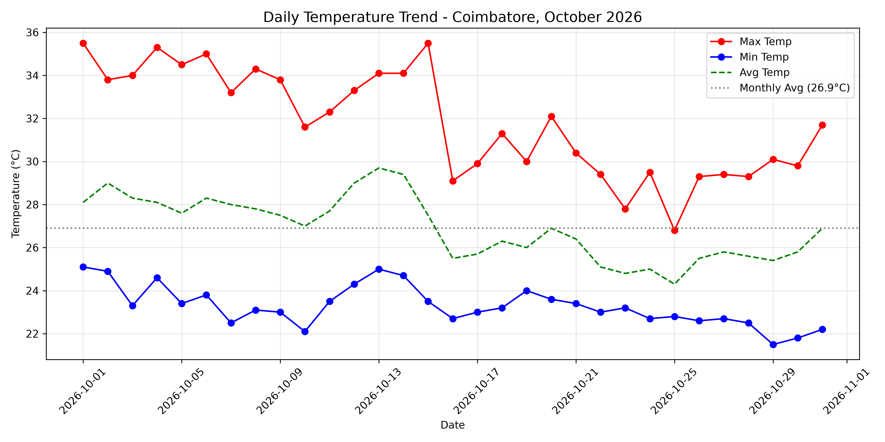
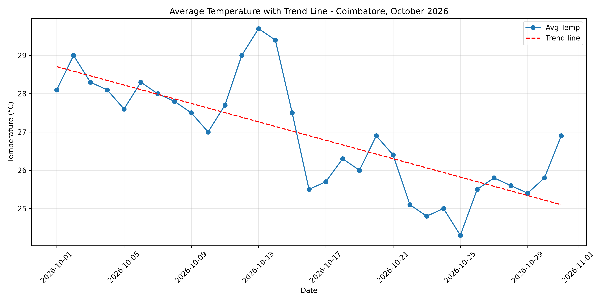
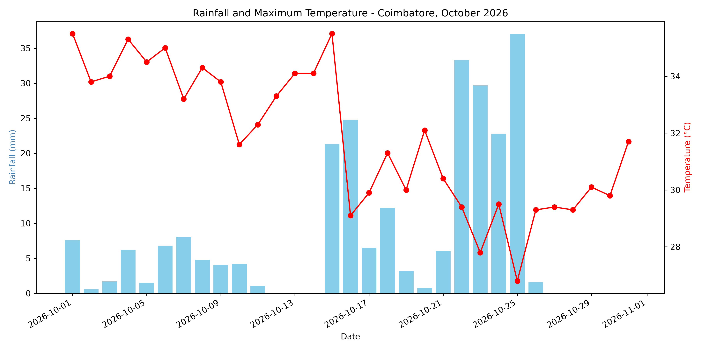

# Weather Data Analysis: Temperature Trends in Coimbatore (October 2026)

## Objective
Analyze 31 days of daily temperature data for Coimbatore to find the maximum, minimum
and average temperature, and to study how temperature changed through the month.

## Data Source
- **Source:** Open-Meteo Historical Weather API (https://open-meteo.com), licensed CC BY 4.0
- **Location:** Coimbatore, Tamil Nadu (about 11.00°N, 76.99°E, elevation 422 m)
- **Period:** 1 October 2026 to 31 October 2026 (31 days)
- **Timezone:** Asia/Kolkata
- **Data used:** hourly temperature (744 readings) and daily maximum and minimum temperature (31 days)

## Tools Used
Python, Pandas, NumPy, Matplotlib, Jupyter Notebook (Anaconda)

## Methodology
1. **Data collection:** downloaded the CSV from the Open-Meteo API
2. **Data cleaning:** checked for missing values, duplicates, date gaps and unrealistic values (none found)
3. **Analysis:** calculated maximum, minimum, average, daily range and weekly averages
4. **Trend analysis:** fitted a straight line (linear regression) to the daily average temperature
5. **Visualization:** line graphs of temperature, a trend line and a rainfall chart

## Results

| Measure | Value |
|---|---|
| Maximum temperature | **35.5 °C** (1 Oct and 15 Oct, tied) |
| Minimum temperature | **21.5 °C** (29 Oct) |
| Average temperature | **26.9 °C** |
| Average of daily maximums | 31.8 °C |
| Average of daily minimums | 23.3 °C |
| Average daily range (max − min) | 8.5 °C |
| Largest daily range | 12.0 °C (15 Oct: 35.5 °C to 23.5 °C) |
| Smallest daily range | 4.0 °C (25 Oct: 26.8 °C to 22.8 °C) |
| Warmest day on average | 13 Oct (29.7 °C) |
| Coolest day on average | 25 Oct (24.3 °C) |
| Days with maximum of 34 °C or more | 9 days |
| Days with maximum below 30 °C | 10 days |

### Weekly average temperature (°C)

| Week | Dates | Avg Max | Avg Min | Avg Temp |
|---|---|---|---|---|
| 1 | 1-7 Oct | 34.5 | 23.9 | 28.2 |
| 2 | 8-14 Oct | 33.4 | 23.7 | 28.3 |
| 3 | 15-21 Oct | 31.2 | 23.3 | 26.4 |
| 4 | 22-28 Oct | 28.8 | 22.8 | 25.2 |
| 5 | 29-31 Oct (3 days) | 30.5 | 21.8 | 26.1 |

### Trend analysis
- The overall trend was **falling**, by about **0.119 °C per day** (roughly 3.7 °C across the month).
- The average temperature was **28.2 °C** from 1 to 15 Oct and **25.7 °C** from 16 to 31 Oct, a drop of about 2.5 °C.
- Daily maximums fell faster (about 0.217 °C per day) than daily minimums (about 0.064 °C per day).
- The average daily maximum was **34.0 °C** in the first half and **29.7 °C** in the second half.
- The largest one-day fall in maximum temperature was **6.4 °C**, from 35.5 °C on 15 Oct to 29.1 °C on 16 Oct.
- Temperatures rose slightly at the end of the month. The maximum went from 29.8 °C on 30 Oct to 31.7 °C on 31 Oct.
- **Rainfall:** total __ mm over __ rainy days *(take these from Cell 5 of the notebook)*

## Graphs

### Daily temperature trend

### Average temperature with trend line

### Rainfall and maximum temperature

## Conclusion
October 2026 in Coimbatore started hot and became noticeably cooler. Daytime
temperatures fell sharply after 15 October, while nighttime temperatures changed much
less, so the gap between day and night narrowed. The hottest reading was 35.5 °C and
the coolest was 21.5 °C, with a monthly average of 26.9 °C. This analysis covers a single
month, so it describes what happened in October 2026 and does not show a long-term
climate pattern.

## Files in this Repository
- `weather analysis.ipynb`: full code, outputs and graphs
- `weather raw data.csv`: raw data downloaded from Open-Meteo
- `coimbatore_oct2026.xls` and `cleaned_weather_data.xls`: data files used and produced by the notebook
- `graph1_temperature_trend.png`, `graph2_trend_line.png`, `graph3_rain_temp.png`: saved graphs

## How to Run
1. Install Anaconda and open Jupyter Notebook.
2. Place the data file in the same folder as the notebook.
3. Open `weather analysis.ipynb` and click **Kernel, then Restart & Run All**.

## Author
Akilesh, 1st Year Data Analytics
